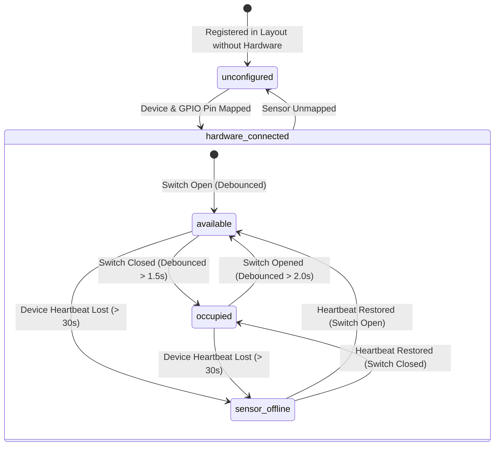

# SILENTRA — System Architecture Specification

## 1. Executive Summary & Purpose

**SILENTRA** is an enterprise-grade Smart Library Intelligence and Monitoring System engineered to bridge physical IoT hardware sensing with a high-fidelity digital twin. It provides library administrators, patrons, and facilities managers with real-time insight into:
- Real-time directional headcount (entry/exit flow).
- Micro-level seat occupancy status.
- Decibel sound pressure levels (dB SPL) and acoustic noise hotspots.
- Unified 2D architectural floor plans and 3D digital-twin spatial visualizations.
- Proactive real-time alerts for noise violations and equipment degradation.

The initial hardware prototype operates with an **ESP32 DevKit V1**, **2 KW11-3Z mechanical microswitches**, **2 IR break-beam sensor channels**, **1 INMP441 I2S MEMS microphone**, **1 OLED/LCD display module**, and **1 piezoelectric buzzer**. 

The architecture is explicitly designed to scale seamlessly from this two-seat prototype to multi-floor, multi-wing campus facilities housing hundreds of dynamically configured zones and seats.

---

## 2. High-Level Architectural Topology

```
+----------------------------------------------------------------------------------------------------+
|                                      PHYSICAL IOT LAYER                                            |
|                                                                                                    |
|  [IR Break-beam 1 & 2]    [KW11-3Z Switch 1 & 2]    [INMP441 I2S Mic]   [OLED Display]  [Buzzer]   |
|         Gate IN/OUT             Seat 1 & 2              Zone A dB           Status      Audible    |
|              \                      |                       /                 ^            ^       |
|               +---------------------+----------------------+                  |            |       |
|                                     |                                         |            |       |
|                               [ESP32 DevKit V1] ------------------------------+------------+       |
|                               (WiFi 802.11 b/g/n)                                                  |
+-------------------------------------|--------------------------------------------------------------+
                                      | MQTT over TLS/TCP (Port 1883)
                                      v
+----------------------------------------------------------------------------------------------------+
|                                    MESSAGE BROKER LAYER                                            |
|                                                                                                    |
|                             Eclipse Mosquitto MQTT Broker                                          |
|                 Topics: silentra/{env}/{building}/floor/{fl}/...                                   |
+-------------------------------------|--------------------------------------------------------------+
                                      | Async MQTT (asyncio-mqtt)
                                      v
+----------------------------------------------------------------------------------------------------+
|                                    BACKEND SERVICES LAYER (Python / FastAPI)                       |
|                                                                                                    |
|  +------------------------+  +------------------------+  +---------------------------------------+ |
|  |     MQTT Consumer      |  |  Demo Simulator Engine |  |       Data Ingestion Gateway          | |
|  |  (Hardware Collector)  |  |  (Synthetic Sandbox)   |  |   - Source Origin Tagging             | |
|  +-----------+------------+  +-----------+------------+  |     (HARDWARE vs SIMULATION)          | |
|              \                           /               |   - Strict Isolation Barrier          | |
|               +------------+------------+                +-------------------+-------------------+ |
|                            |                                                 |                     |
|                            v                                                 v                     |
|  +-----------------------------------------------------------------------------------------------+ |
|  |                                  Domain Services Layer                                        | |
|  |   - OccupancyManager (Debouncing, State transitions, Allocation verification)                 | |
|  |   - AcousticAnalyzer (Leq computation, Rolling averages, Hotspot detection)                   | |
|  |   - HeadcountEngine (Directional differential, Capacity thresholds)                           | |
|  |   - NotificationEngine (WebSocket push, Buzzer triggers, On-screen messages)                 | |
|  +-----------------------------------------------------------------------------------------------+ |
|                            |                                                 |                     |
|                            v                                                 v                     |
|  +------------------------------------+             +--------------------------------------------+ |
|  |   PostgreSQL 16 (Async SQLAlchemy) |             |        FastAPI Transport Endpoints         | |
|  |   - Relational Core & Historical   |             |   - REST API (/api/v1/*)                   | |
|  |   - Time-series noise & occupancy  |             |   - WebSocket Hub (/api/v1/ws)             | |
|  +------------------------------------+             +---------------------+----------------------+ |
+---------------------------------------------------------------------------|------------------------+
                                                                            | HTTP / WebSockets
                                                                            v
+----------------------------------------------------------------------------------------------------+
|                                    FRONTEND LAYER (React + TypeScript)                             |
|                                                                                                    |
|  +-----------------------------------------------------------------------------------------------+ |
|  |                                     Zustand Global State Store                                | |
|  |   - Live Seats  - Headcount  - Noise Telemetry  - Active Alerts  - Floor Layout  - Filter/Time| |
|  +-----------------------------------------------------------------------------------------------+ |
|         |                                           |                                     |        |
|         v                                           v                                     v        |
|  +--------------------+                   +--------------------+                +----------------+ |
|  |   2D Floor Plan    | <=== SYNCED ====> | 3D Digital Twin    |                | Management &   | |
|  |   (SVG/Canvas      |    (Single Source | (Three.js / R3F)   |                | Analytics Tabs | |
|  |    of Truth)       |      of Truth)    | Isometric Orbit    |                | Table & Charts | |
|  +--------------------+                   +--------------------+                +----------------+ |
+----------------------------------------------------------------------------------------------------+
```

---

## 3. Strict Architectural Boundaries & Modular Decoupling

The SILENTRA architecture strictly isolates concerns into isolated functional domains:

### 3.1. Frontend Presentation Layer (`frontend/`)
- Purely declarative React 19 / TypeScript SPA with zero knowledge of database schemas, direct MQTT sockets, or hardware GPIOs.
- Communicates exclusively via structured REST API endpoints and strongly-typed WebSocket events.
- Adheres strictly to the **Approved Product Design**:
  - Inter typography.
  - Approved Forest Green palette (`#245B45`, `#173D30`, `#FAFAF7`, `#F1F3F0`, `#252B28`, `#DDE2DC`).
  - Minimalist enterprise layout with a compact header and horizontal tabs (no permanent left sidebar).
  - Clean, functional visualizations without AI gimmicks, glassmorphism, or neon embellishments.

### 3.2. Application Business Logic Layer (`backend/app/services/`)
- Encapsulates domain logic independent of transport protocols (HTTP, MQTT, WebSockets):
  - **Seat State Machine**: Validates transitions between `available`, `occupied`, `sensor_offline`, `unconfigured`, and `hardware_connected`.
  - **Acoustic Analyzer**: Calculates rolling $L_{eq}$ (equivalent continuous sound level) over configurable sliding windows (10s, 60s, 5m), detects anomalous spikes, and flags noise hotspot coordinates.
  - **Gate Traversal Counter**: Resolves directional dual-beam sequences (Beam A $\rightarrow$ Beam B = Entry; Beam B $\rightarrow$ Beam A = Exit) and guarantees non-negative headcount.

### 3.3. Database Persistence Layer (`backend/app/db/` & `models/`)
- Utilizes SQLAlchemy 2.0 Async ORM with Alembic schema versioning.
- Provides optimized relational indexing, composite unique constraints (e.g. `(floor_id, seat_code)`), and audit event trails.
- Includes SQLite fallback configuration for instant developer onboarding without local database servers.

### 3.4. Hardware & MQTT Communication Layer (`backend/app/mqtt/` & `firmware/`)
- Handles broker connectivity, subscription filtering, payload validation against Pydantic schemas, and broker keepalives.
- Decouples raw hardware topics from backend internal pub/sub events.

### 3.5. Real Sensor vs Demo Simulation Boundary (Zero Data Contamination)
> [!IMPORTANT]
> **Strict Non-Contamination Rule**: Never mix simulated readings with actual hardware readings.
> Physical hardware data and synthetic simulation data are processed through strictly isolated channels:
> 1. **Data Source Tagging**: All telemetry events, database records, and WebSocket payloads carry an immutable `data_origin` field (`HARDWARE` or `SIMULATION`).
> 2. **Physical Sensor Exclusivity**: The physical prototype (ESP32) maps to dedicated hardware entities (e.g., Seat 1 = `FL01-ZNA-S001`, Seat 2 = `FL01-ZNA-S002`, Gate 1 = `FL01-GATE-01`, Mic 1 = `FL01-MIC-01`). The simulation worker is structurally forbidden from emitting events on entities registered to active physical devices.
> 3. **Configurable Runtime Modes**:
>    - `HYBRID` (Default): Physical hardware drives assigned seats/gates/mic; the simulator generates realistic synthetic activity for unmonitored virtual desks across other floors/zones.
>    - `HARDWARE_ONLY`: Simulator is completely disabled. Only real ESP32 sensor signals enter the system.
>    - `SIMULATION_ONLY`: Full synthetic sandbox for testing, UI validation, and demonstration without physical boards connected.
> 4. **Visual Differentiation**: In the UI, any seat or reading originating from simulation is flagged with a subtle, non-intrusive `[Simulated]` indicator so operators are never misled.

---

## 4. Unified 2D Floor Plan & 3D Digital Twin Architecture

To prevent discrepancies between flat architectural plans and the 3D representation:
1. **Single Source of Truth**:
   The 2D architectural floor plan definition (stored in JSON/database as `floor_geometry`) defines the definitive coordinate system:
   - Metric world coordinates ($x, y$ in meters, relative to the floor origin $[0,0]$ at the top-left corner).
   - Zone boundary polygons ($[(x_1, y_1), (x_2, y_2), ...]$).
   - Seat placement coordinates ($x, y$, orientation angle $\theta$).
   - Obstacles, walls, doorways, and service desks.

2. **Parametric 3D Projection**:
   The Three.js / React Three Fiber renderer maps the 2D layout deterministically:
   - $X_{3D} = x_{2D} - \frac{\text{Width}}{2}$
   - $Z_{3D} = y_{2D} - \frac{\text{Height}}{2}$
   - $Y_{3D} = \text{Height offset from floor surface} + \text{Floor Level} \times \text{Floor Height}$
   - Isometric default camera angle (Azimuth 45°, Elevation 35.264°, Orthographic/Perspective blend).

3. **Shared Identifiers**:
   Seat selection, hover state, heatmap vertex coordinates, and noise intensity centers reference the exact same `seat_code` and `zone_id` across both 2D and 3D views.

---

## 5. Seat State Lifecycle Machine

Every seat in SILENTRA exists in exactly one well-defined state:



- **`unconfigured`**: Seat exists in the floor layout but has no physical sensor or simulation profile bound.
- **`hardware_connected`**: Physical IoT device and sensor assignment is verified.
- **`available`**: Chair switch is open; no user is seated; ready for occupancy.
- **`occupied`**: Chair switch is pressed and debounced; occupied by patron.
- **`sensor_offline`**: The parent microcontroller has failed to emit a heartbeat within the timeout threshold ($\tau = 30\text{s}$), or telemetry reports a sensor fault.
