# SILENTRA — Database Architecture & Entity Specification

## 1. Relational Model Overview

SILENTRA uses **PostgreSQL 16** with **SQLAlchemy 2.0 (Async)** as its persistent storage engine. The database is architected to balance transactional integrity for real-time facility operations (seat allocation, alert handling, device pairing) with high-throughput append-only time-series telemetry (noise readings, occupancy transitions, gate passages).

---

## 2. Entity-Relationship Diagram

```mermaid
erDiagram
    USERS ||--o{ ALERTS : acknowledges
    STUDENTS ||--o{ SEAT_ALLOCATIONS : books
    STUDENTS ||--o{ OCCUPANCY_EVENTS : generates

    FLOORS ||--|{ ZONES : contains
    FLOORS ||--o{ DEVICES : hosts
    FLOORS ||--o{ ENTRY_EXIT_EVENTS : records
    FLOORS ||--o{ ALERTS : targets

    ZONES ||--|{ SEATS : contains
    ZONES ||--o{ NOISE_READINGS : gathers
    ZONES ||--o{ ALERTS : triggers

    DEVICES ||--|{ SENSOR_ASSIGNMENTS : mounts
    DEVICES ||--o{ NOISE_READINGS : measures
    DEVICES ||--o{ ALERTS : reports

    SEATS ||--o{ SENSOR_ASSIGNMENTS : monitored_by
    SEATS ||--o{ SEAT_ALLOCATIONS : assigned_to
    SEATS ||--o{ OCCUPANCY_EVENTS : logs
    SEATS ||--o{ ALERTS : triggers

    USERS {
        uuid id PK
        string email UK
        string hashed_password
        string full_name
        string role "ADMIN | LIBRARIAN | VIEWER"
        boolean is_active
        timestamp created_at
    }

    STUDENTS {
        uuid id PK
        string student_id UK "e.g., STU-2024-8841"
        string card_uid UK "RFID / Barcode UID"
        string full_name
        string email UK
        string department
        boolean is_active
        timestamp created_at
    }

    FLOORS {
        uuid id PK
        integer floor_number UK
        string name "e.g., Ground Floor - Main Stacks"
        float width_meters
        float length_meters
        jsonb floor_geometry "2D walls, portals, layout"
        integer max_capacity
        boolean is_active
    }

    ZONES {
        uuid id PK
        uuid floor_id FK
        string zone_code "e.g., ZN-01A"
        string name "Quiet Study Carrels"
        string zone_type "QUIET | COLLABORATIVE | SILENT | GENERAL"
        jsonb boundary_polygon "Coordinates relative to floor"
        float noise_threshold_db "e.g., 55.0 dB"
        integer capacity
    }

    SEATS {
        uuid id PK
        uuid floor_id FK
        uuid zone_id FK
        string seat_code UK "e.g., FL01-ZNA-S001"
        float coord_x "meters from origin"
        float coord_y "meters from origin"
        float rotation_deg
        string seat_type "DESK_CHAIR | CARREL | STANDING | SOFA"
        boolean has_power_outlet
        string status "AVAILABLE | OCCUPIED | OFFLINE | UNCONFIGURED"
        boolean is_monitored_by_hardware
        boolean is_simulated
    }

    DEVICES {
        uuid id PK
        string device_code UK "e.g., ESP32-PROTOTYPE-01"
        string mac_address UK "AA:BB:CC:DD:EE:01"
        string ip_address
        string firmware_version
        uuid floor_id FK
        string status "ONLINE | OFFLINE | DEGRADED"
        timestamp last_seen_at
    }

    SENSOR_ASSIGNMENTS {
        uuid id PK
        uuid device_id FK
        string sensor_type "MICROSWITCH | BREAKBEAM | I2S_MIC"
        string channel_or_pin "GPIO_14 | CH_A | I2S_PORT0"
        uuid target_seat_id FK "nullable (for seat switches)"
        uuid target_zone_id FK "nullable (for noise mics)"
        uuid target_floor_id FK "nullable (for entry gates)"
        string physical_location_desc
        boolean is_active
    }

    OCCUPANCY_EVENTS {
        uuid id PK
        uuid seat_id FK
        uuid student_id FK "nullable"
        string previous_status
        string new_status
        integer duration_seconds
        string event_source "HARDWARE | SIMULATION | MANUAL"
        timestamp event_timestamp
    }

    ENTRY_EXIT_EVENTS {
        uuid id PK
        uuid floor_id FK
        string gate_identifier "e.g., MAIN_PORTAL_NORTH"
        string direction "IN | OUT"
        string sensor_channel
        string event_source "HARDWARE | SIMULATION"
        timestamp event_timestamp
    }

    NOISE_READINGS {
        uuid id PK
        uuid zone_id FK
        uuid device_id FK
        float decibel_spl "A-weighted equivalent continuous dB"
        float peak_decibel
        boolean is_exceeded
        string event_source "HARDWARE | SIMULATION"
        timestamp recorded_at
    }

    ALERTS {
        uuid id PK
        string alert_type "NOISE_VIOLATION | SENSOR_FAULT | OVER_CAPACITY | INACTIVITY"
        string severity "INFO | WARNING | CRITICAL"
        uuid floor_id FK
        uuid zone_id FK
        uuid seat_id FK
        uuid device_id FK
        string message
        boolean is_acknowledged
        uuid acknowledged_by FK
        timestamp acknowledged_at
        timestamp resolved_at
        timestamp created_at
    }

    SEAT_ALLOCATIONS {
        uuid id PK
        uuid seat_id FK
        uuid student_id FK
        timestamp start_time
        timestamp end_time
        string status "ACTIVE | COMPLETED | CANCELLED | NO_SHOW"
        timestamp checked_in_at
        timestamp checked_out_at
    }
```

---

## 3. Entity Catalog & Architectural Justification

### 1. `users`
- **Purpose**: Authenticated library staff, administrators, and facilities operators.
- **Access Control**: Roles (`ADMIN`, `LIBRARIAN`, `VIEWER`). Protects configuration APIs, device mapping, calibration thresholds, and alert acknowledgments.

### 2. `students`
- **Purpose**: Library patrons.
- **Attributes**: Tracks institutional `student_id`, card RF/barcode UID, email, and affiliation.
- **Role**: Allows optional reservation and auto-check-in matching when RFID/barcode readers or portal cards are linked to seat occupancies.

### 3. `floors`
- **Purpose**: Architectural containment boundary.
- **Single Source of Truth**: Contains `floor_geometry` (JSON), bounding box dimensions (`width_meters`, `length_meters`), and building level index. Both 2D layouts and 3D scenes load this geometry.

### 4. `zones`
- **Purpose**: Functional library sub-regions with distinct behavioral policies (e.g. "Silent Study Zone", "Group Collaboration Pods").
- **Acoustic Policies**: Sets localized `noise_threshold_db` (e.g., 45 dB for Silent, 70 dB for Collaboration). Used by the noise hotspot detection algorithm.

### 5. `seats`
- **Purpose**: Granular monitored seating unit.
- **Precision Spatial Coordinates**: Stores metric coordinates (`coord_x`, `coord_y`, `rotation_deg`) aligned with `floor_geometry`.
- **Hardware vs Virtual**: Flagged with `is_monitored_by_hardware` (true for prototype Seats 1 & 2) and `is_simulated`.

### 6. `devices`
- **Purpose**: Physical IoT hardware units (e.g., ESP32 DevKit V1 microcontrollers).
- **Health Tracking**: Tracks MAC address, IP address, firmware version, RSSI, and `last_seen_at` for heartbeat/LWT timeout detection.

### 7. `sensor_assignments`
- **Purpose**: Decoupled mapping layer between physical hardware pins/channels and logical entities.
- **Architectural Value**: Eliminates hardcoded pin numbers in application code. If a microswitch is moved from GPIO 14 to GPIO 27, it is remapped in this table without modifying firmware code or database schemas.

### 8. `occupancy_events`
- **Purpose**: Immutable time-series audit trail of seat occupancy state transitions.
- **Telemetry Partitioning**: Carries `event_source` (`HARDWARE` vs `SIMULATION`), preventing any synthetic event from corrupting physical sensor metrics.

### 9. `entry_exit_events`
- **Purpose**: Time-series log of people passing through monitored entry/exit gates.
- **Computation**: Enables high-precision real-time headcount calculation ($\text{Headcount} = \sum \text{IN} - \sum \text{OUT}$) per floor and library-wide.

### 10. `noise_readings`
- **Purpose**: Time-series sound pressure level measurements sampled by the INMP441 I2S microphone.
- **Acoustic Profiling**: Stores $L_{Aeq}$ decibel SPL and peak readings. Queried by the 2D/3D heatmap generator to render color gradients.

### 11. `alerts`
- **Purpose**: Incident and notification tracking for library staff.
- **Incident Types**: Noise threshold violations, sensor disconnects, unauthorized occupancy, and capacity limit exceedances. Tracks acknowledgment lifecycle by librarians.

### 12. `seat_allocations`
- **Purpose**: Reservation and check-in session state.
- **Behavior**: Correlates student reservations with physical occupancy detected by microswitches to identify "no-show" desk hoarding.

---

## 4. Key Performance Indexes & Constraints

1. **Unique Identity Constraints**:
   - `seats(floor_id, seat_code)`: Enforces unique seat numbering per floor.
   - `devices(mac_address)`: Ensures unique physical hardware addressing.
   - `sensor_assignments(device_id, channel_or_pin)`: Prevents pin collision on the same device.

2. **Time-Series Query Optimization**:
   - `idx_occupancy_events_seat_time`: `(seat_id, event_timestamp DESC)` for instant latest seat state lookups.
   - `idx_noise_readings_zone_time`: `(zone_id, recorded_at DESC)` for high-frequency heatmap generation.
   - `idx_entry_exit_floor_time`: `(floor_id, event_timestamp DESC)` for rapid real-time headcount computation.
