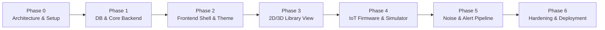

# SILENTRA — Implementation Roadmap & Execution Plan

## 1. Project Phase Overview

---

## 2. Phase-by-Phase Deliverables

### Phase 0: Project Initialization & Architecture (Current Phase)
- **Goal**: Establish the complete architectural foundation, boundary definitions, database schema, MQTT specifications, and project skeleton.
- **Deliverables**:
  - Technical architecture specification (`docs/architecture.md`).
  - Database ER diagram and 12-entity catalog (`docs/database-schema.md`).
  - MQTT topic taxonomy and sensor JSON schemas (`docs/mqtt-specification.md`).
  - REST & WebSocket API specification (`docs/api-specification.md`).
  - Monorepo directory structure and project configs (`.env.example`, `docker-compose.yml`, `.gitignore`).
  - Environment and dependency assessment.

---

### Phase 1: Database Foundation & Core Backend API
- **Goal**: Implement the asynchronous database models, Alembic migrations, base seed data, and CRUD REST APIs.
- **Key Deliverables**:
  - SQLAlchemy 2.0 Async models for all 12 entities with relationships and constraints.
  - Alembic migration scripts initializing tables and composite indexes.
  - Pydantic v2 schemas for request validation and serialization.
  - Core API endpoints: Floors, Zones, Seats, Headcount, and Devices.
  - SQLite async fallback configuration for zero-setup local execution.
  - Unit tests for database models and API routers using `pytest` and `httpx`.

---

### Phase 2: Frontend Layout, Design System & Navigation
- **Goal**: Implement the modern, minimalist enterprise interface adhering strictly to the design system.
- **Key Deliverables**:
  - Vite + React 19 + TypeScript + Tailwind CSS setup.
  - Theme configuration: Forest Green (`#245B45`), Deep Forest (`#173D30`), Warm White (`#FAFAF7`), Charcoal (`#252B28`).
  - Inter typography and shadcn/ui components.
  - Compact header with horizontal tab navigation:
    1. Overview
    2. Library View
    3. Floor Management
    4. Seats & Users
    5. Noise Monitoring
    6. Analytics
    7. Reports
    8. Settings
  - Global state management (Zustand) and WebSocket subscription manager.

---

### Phase 3: Unified 2D Floor Plan & 3D Interactive Library View
- **Goal**: Deliver the dedicated interactive Library View featuring dual-synchronized 2D and 3D digital twins.
- **Key Deliverables**:
  - Shared floor plan coordinate geometry parser (single source of truth).
  - 2D architectural SVG/Canvas interactive floor plan.
  - 3D workspace using Three.js / React Three Fiber / Drei:
    - Default isometric camera view.
    - Free orbit, pan, zoom, and reset camera controls.
    - Procedural chair models color-coded by state:
      - Green: Available
      - Forest Green / Charcoal: Occupied
      - Amber: Maintenance / Warning
      - Muted Grey: Offline / Unconfigured
    - Real-time seat hover preview tooltip and click detail panel.
    - Dynamic occupancy and noise heatmaps mapped directly onto floor meshes.
    - Fullscreen toggle and floor/zone selectors.

---

### Phase 4: IoT Firmware, MQTT Ingestion & Dual Ingestion Pipeline
- **Goal**: Deliver the ESP32 prototype firmware, the asyncio MQTT ingestion service, and the isolated demo simulator.
- **Key Deliverables**:
  - ESP32 C++ firmware (PlatformIO / Arduino-ESP32):
    - Microswitch interrupt debounce logic for Seats 1 & 2.
    - Directional IR break-beam sequence decoder for Gate 1.
    - INMP441 I2S DMA acoustic sampling and RMS dB SPL conversion.
    - SSD1306 OLED local display feedback and piezo buzzer tones.
    - MQTT client with auto-reconnect and LWT.
  - Backend MQTT consumer daemon with payload validation and error isolation.
  - `demo_simulator.py`: Synthetic generator for unmonitored floors/zones.
  - Zero-contamination verification: Guarantees simulated readings never touch hardware-allocated entities.

---

### Phase 5: Noise Monitoring, Alerts & Real-Time Librarian Notifications
- **Goal**: Complete the operational intelligence suite for library managers.
- **Key Deliverables**:
  - Real-time acoustic noise threshold detection ($L_{Aeq}$ calculation, sliding window spike analysis).
  - Noise hotspot visualizer on 2D and 3D floor maps.
  - Automated librarian alert dispatching with audible buzzer triggers on the physical ESP32.
  - Live alert acknowledgment and resolution workflows in the frontend.
  - Directional headcount dashboard displaying live facility occupancy vs fire safety limits.

---

### Phase 6: Analytics, Reporting, System Hardening & Docker Containerization
- **Goal**: Finalize production reporting, security auditing, and deployment orchestration.
- **Key Deliverables**:
  - Analytics dashboards: Peak occupancy hours, average study dwell times, noise pattern trends.
  - Exportable compliance and utilization reports (CSV / PDF export).
  - Production Dockerfiles with multi-stage builds for frontend and backend.
  - Docker Compose orchestration with automated healthchecks.
  - Full end-to-end integration tests and user documentation.
